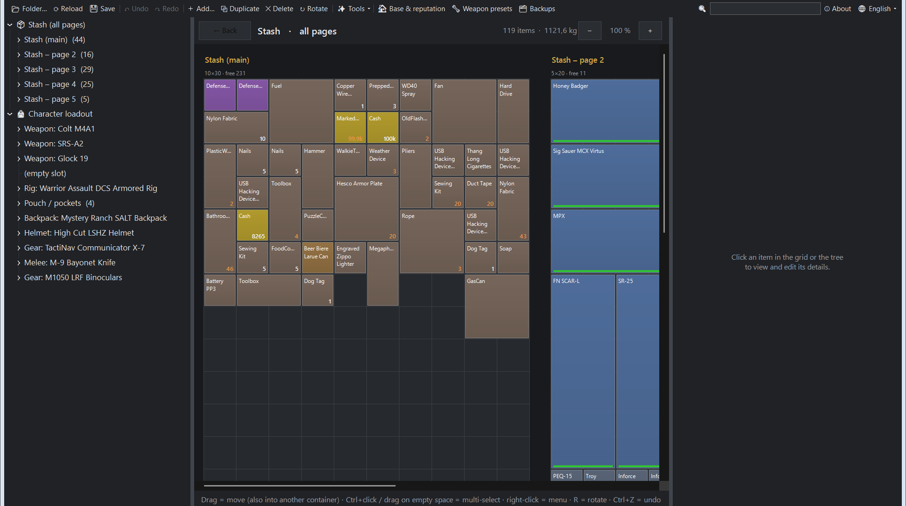
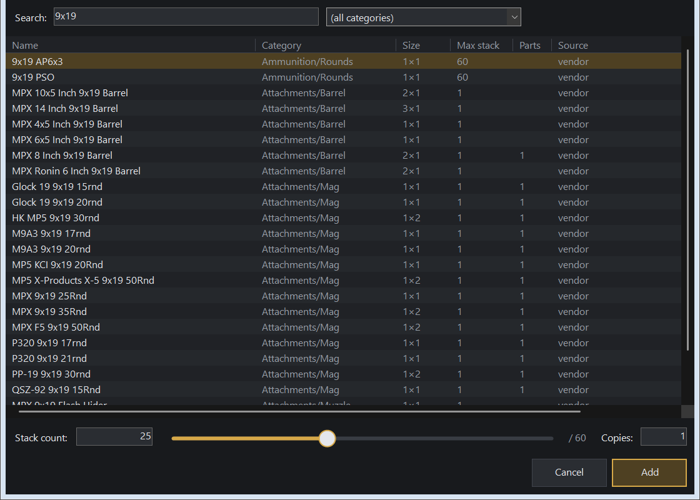
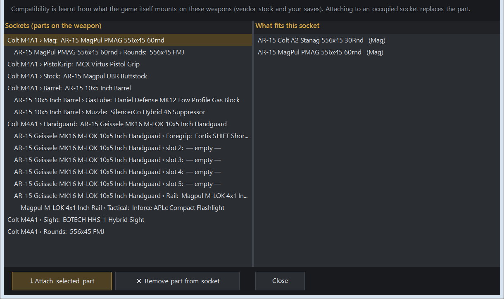

<p align="center"></p>

<h1 align="center">IRR Inventory Editor</h1>

<p align="center">
Unofficial save editor for <b>Incursion Red River</b>: stash, character loadout, weapon parts, hideout and faction reputation.<br>
Dark, DPI-sharp UI · English / Čeština · no install, no dependencies
</p>


## Download

Download `IRR-InventoryEditor.zip` from the [latest release](../../releases/latest), unzip it anywhere and run `IRR-InventoryEditor.exe`.
Windows 10/11 only. It needs .NET Framework 4.x, which ships with Windows.

> SmartScreen may warn the first time because the exe isn't signed: **More info → Run anyway**.

The editor finds your saves automatically in `%LOCALAPPDATA%\Test_C\Saved\SaveGames` (`Test_C` is the game's internal name). To use another folder, click **📂 Folder…**.

## Features

### Stash & loadout


- **Visual grids** for the stash (every page side by side), backpack, rig and pouch. Tiles are coloured by category and show the stack count and a durability bar.
- **Move anything anywhere**:
  - drag items between stash pages, backpack, rig and pouch,
  - or right-click → *Move to…*, which also works between the stash and the character loadout.
- **Character loadout overview**: every equipment slot plus the contents of the rig, pouch and backpack.
- **Multi-select** with Ctrl+click or by dragging a box on empty space. Delete, Repair and Move then apply to all selected items.
- **Undo / Redo** (Ctrl+Z / Ctrl+Y) for every change.
- **Search** (Ctrl+F): matching items are highlighted in the grid and the tree, and Enter jumps to the next one.
- **Zoom** the grid with Ctrl+wheel or the − / + buttons.
- **Item details**: edit count, max stack, quest flag and every stat (durability, ergonomics, recoil…).

### Adding items


- Pick from a catalog of ~800 items, built from the vendor stock in your own saves.
- Set the stack size by **typing it or with a slider**, and add several copies at once.
- Weapons come **fully assembled** with magazine and ammo. Items are auto-placed in the first free spot (rotated if needed) and get fresh UIDs.

### Weapon parts & presets


- **Attach, swap or remove parts** on any weapon. Compatibility is learnt from what the game itself mounts on that weapon, so you only see parts that fit.
- **Detach** a part straight into the stash.
- **Gunsmith presets**: browse, rename, duplicate and delete.

### 🏠 Base & reputation
- Hideout facility levels (−1 = not built) and the "track" flag. Cached upgrade requirements can be cleared (experimental).
- Hideout resources (oil, concrete, metal, food) and their maximums.
- Player level, XP and loyalty with GREYFOR, BLUEFOR, OPFOR and FANG.

### Smart tools
- Repair everything to new-item durability.
- Fill all stacks, or fill magazines (capacity is read from the name).
- Merge stacks and sort a container.
- Check for overlaps.
- Unlock stash cells (experimental).

## Safety

- The **whole save folder is backed up** to `SaveGames\_IRR_Editor_Backups\<timestamp>\` before every save. **🗂 Backups** lists them and restores one with a click; your current saves are backed up first.
- Saving is blocked while the game is running. If the game wrote the saves while the editor was open, the editor notices and asks before overwriting.
- The GVAS parser is **lossless**: an unmodified save is written back byte-for-byte identical, and every written file is parsed again before it replaces the original.
- `VendorSaveGame.sav` is only read, never written.
- Steam Cloud: only edit while the game is closed. If Steam reports a conflict, choose the local files.

## Build from source

No SDK is needed; the C# compiler that ships with Windows is enough:

```bat
build.bat
```

Every push is built by GitHub Actions, and pushing a `v*` tag publishes a release automatically. The icon is generated by `tools/MakeIcon.cs`.

| File | Contents |
|---|---|
| `src/Gvas.cs` | Lossless reader/writer for UE 5.4+ GVAS saves (new property-tag format, maps, sets) |
| `src/Model.cs` | Containers, grids, items, catalog, part compatibility, moving and cloning |
| `src/Undo.cs` | Snapshot-based undo / redo |
| `src/Tools.cs` | Bulk "smart" operations |
| `src/Base.cs`, `src/Gunsmith.cs` | Hideout / resources / reputation, weapon presets |
| `src/GridPanel.cs` | The custom-drawn inventory grid |
| `src/MainForm.cs`, `src/AddItemForm.cs`, `src/Dialogs.cs` | Windows and dialogs |
| `src/Theme.cs`, `src/Lang.cs` | Dark theme and DPI scaling, Czech / English strings |
| `src/Dump.cs`, `src/Analyze.cs`, `src/Shots.cs` | Developer tools (tree dump, round-trip and feature tests, off-screen screenshots) |

## License

[GPL-3.0](LICENSE). You may use, modify and share it, but modified versions must stay open source under the same license.

## Disclaimer

This is a fan-made tool, **not affiliated with Games Farm**. Use it at your own risk and keep your backups.

---

### Česky

Neoficiální editor savů pro Incursion Red River. Umí:
- sklad (všechny strany vedle sebe), výbavu, batoh a vestu v přehledných mřížkách,
- přesouvání předmětů mezi kontejnery, a to i mezi skladem a výbavou,
- vícenásobný výběr a Zpět/Znovu,
- hledání a zoom,
- přidávání předmětů s posuvníkem pro počet,
- nasazování a výměnu dílů zbraní a presety Gunsmithu,
- úrovně zařízení v úkrytu, suroviny, level postavy a loajalitu frakcí.

Jazyk přepneš vpravo nahoře (🌐). Před každým uložením se savy zálohují a z okna **🗂 Zálohy** je obnovíš jedním kliknutím. Ukládej jen se zavřenou hrou.
