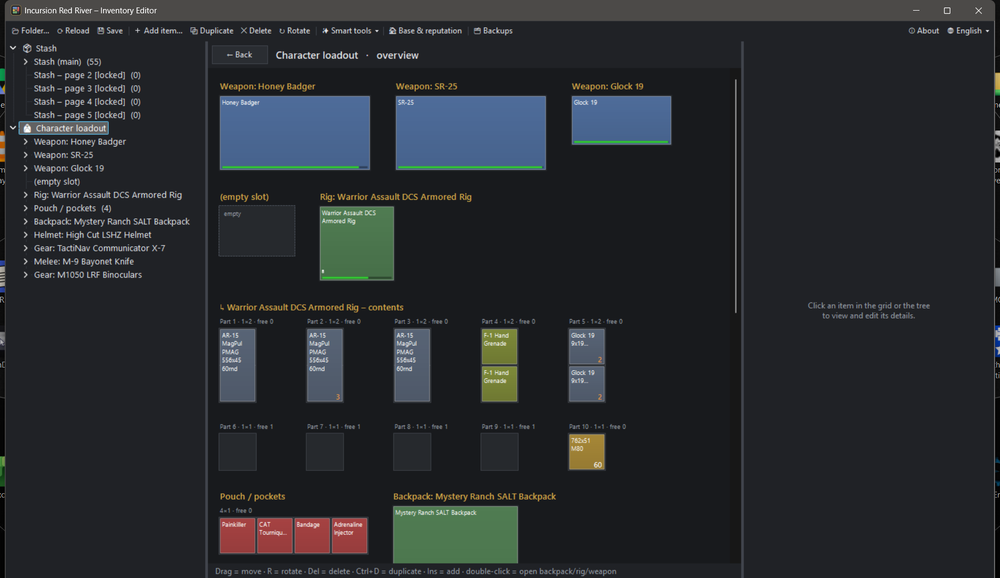
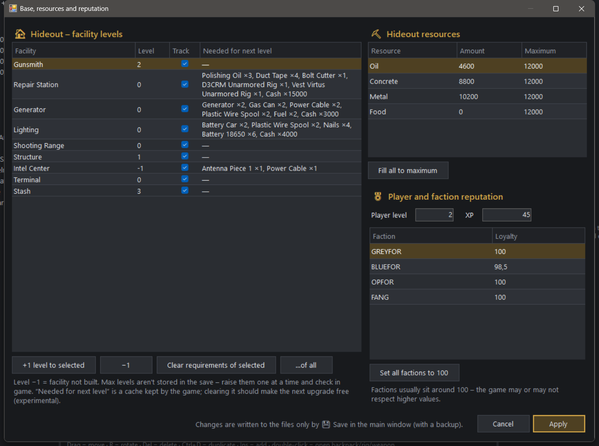

<p align="center"></p>

<h1 align="center">IRR Inventory Editor</h1>

<p align="center">
Unofficial save editor for <b>Incursion Red River</b> – stash, character loadout, hideout and faction reputation.<br>
Dark UI · English / Čeština · no install, no dependencies
</p>



## Download

Grab `IRR-InventoryEditor.zip` from **Releases**, unzip it anywhere and run `IRR-InventoryEditor.exe`.
Windows only. It needs .NET Framework 4.x, which ships with Windows 10 and 11.

> SmartScreen may warn the first time because the exe isn't signed: **More info → Run anyway**.

The editor finds the saves automatically in `%LOCALAPPDATA%\Test_C\Saved\SaveGames` (`Test_C` is the game's internal name). To use a different folder, click **📂 Folder…**.

## Features

**Stash & loadout**
- Visual grid of the stash, backpack, rig and pouch: colour by category, stack counts and a durability bar.
- Drag items to move them, press **R** to rotate, double-click to open a backpack or rig.
- **Character loadout overview**: every equipment slot and the contents of rig, pouch and backpack on one screen.
- Item details: edit count, max stack, quest flag and every stat (durability, ergonomics, recoil…).
- **Add item** (Ins) from a catalog of ~800 items, built from the vendor offers in your own saves:
  - weapons come fully assembled, with magazine and ammo,
  - items are auto-placed in the first free spot, rotated if needed, and get fresh UIDs.
- **Duplicate** (Ctrl+D) and **Delete** (Del), including nested contents. Delete also clears quick-slot references.
- **Smart tools**:
  - repair all to new-item durability,
  - fill stacks,
  - fill magazines (capacity read from the name),
  - merge stacks,
  - sort a container,
  - check for overlaps,
  - unlock stash pages (experimental).

**🏠 Base & reputation**



- Hideout facility levels (−1 = not built) and the "track" flag. You can clear the cached "needed for next level" requirements (experimental).
- Hideout resources: oil, concrete, metal and food, plus their maximums.
- Player level, XP and loyalty with GREYFOR, BLUEFOR, OPFOR and FANG.

## Safety

- The **whole save folder is backed up** to `SaveGames\_IRR_Editor_Backups\<timestamp>\` before every save.
- Saving is blocked **while the game is running**.
- The GVAS parser is **lossless**: an unmodified save is written back byte-for-byte identical. Every written file is parsed again before it replaces the original.
- `VendorSaveGame.sav` is only read, never written.
- The game uses Steam Cloud. Only edit while the game is closed, and if Steam reports a conflict, choose the local files.

## Build from source

No SDK needed. The C# compiler that ships with Windows is enough:

```bat
build.bat
```

The icon is generated by `tools/MakeIcon.cs`.

| File | Contents |
|---|---|
| `src/Gvas.cs` | Lossless reader/writer for UE 5.4+ GVAS saves (new property-tag format, maps, sets) |
| `src/Model.cs` | Containers, grids, items, catalog, template cloning |
| `src/Tools.cs` | Bulk "smart" operations |
| `src/Base.cs` | Hideout / resources / reputation model and window |
| `src/Theme.cs` | Dark theme, dark dialogs, tooltips, number input |
| `src/Lang.cs` | Czech / English strings |
| `src/MainForm.cs` | Main window and grid view |
| `src/Dump.cs`, `src/Analyze.cs` | Developer tools (tree dump, round-trip test) |

## License

[GPL-3.0](LICENSE). You may use, modify and share it, but modified versions must stay open source under the same license.

## Disclaimer

This is a fan-made tool, **not affiliated with Games Farm**. Use it at your own risk and keep your backups.

---

### Česky

Neoficiální editor savů pro Incursion Red River. Umí:
- sklad, výbavu postavy a batohy v mřížce s přetahováním,
- přidávání předmětů z katalogu, zbraně včetně kompletně sestavených dílů,
- chytré nástroje (opravy, doplnění stacků a zásobníků, řazení),
- úrovně zařízení v úkrytu, suroviny, level postavy a loajalitu frakcí.

Jazyk přepneš vpravo nahoře (🌐). Před každým uložením se savy zálohují do `SaveGames\_IRR_Editor_Backups`. Ukládej jen se zavřenou hrou.
